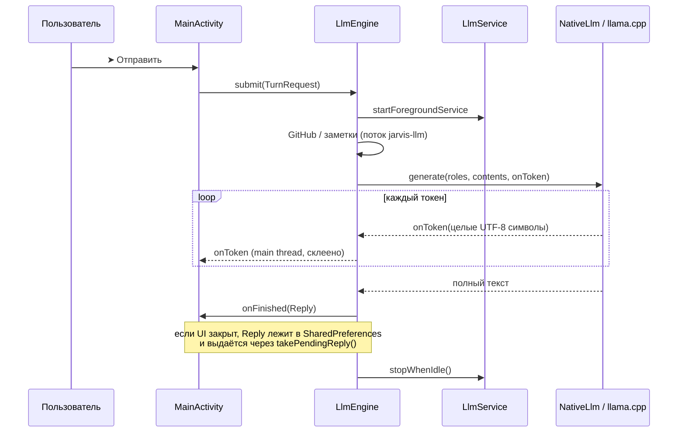

# Архитектура Jarvis (после этапов 1–2)

> Статус: описывает код после патча «стриминг + Стоп + LlmService».
> Патч подготовлен без компиляции Kotlin и без запуска на устройстве, первым делом проверьте сборку и [TESTING.md](TESTING.md).

## Слои

| Слой | Файлы | Что делает |
|---|---|---|
| UI | `MainActivity.kt`, `OrbService.kt`, `OrbView.kt`, экраны `*Activity.kt` | Рисует чат, собирает промпт (system + история), показывает поток. **Генерацией не владеет.** |
| Ход диалога | `LlmEngine.kt`, `ReplyPolicy.kt` | Один ход целиком: GitHub и заметки → контекст → генерация → итоговый ответ. Живёт в процессе, а не в Activity. |
| Жизнь процесса | `LlmService.kt` | Foreground-уведомление «Jarvis думает» с кнопкой «Стоп» и WakeLock на время ответа. Состояния не хранит. |
| Мост | `NativeLlm.kt` ↔ `cpp/native-lib.cpp` | JNI: загрузка модели, генерация, отмена. |
| Движок | llama.cpp (подтягивается `FetchContent` в `CMakeLists.txt`) | Токенизация, KV-кэш, сэмплинг. |
| Инструменты | `GitHubChatTool`, `GitHubApi`, `InternetResearchTool`, `KnowledgeStore` | Дополнительный контекст, только по явному запросу пользователя. |
| Обновления | `UpdateManager`, `InstallResultReceiver` | GitHub Releases → проверка SHA-256 и подписи APK → `PackageInstaller`. |

## Ход диалога

## Правила, которые нельзя ломать

1. **История хранит ответ ровно так, как его сгенерировала модель** (`Reply.text`). Приписки вроде «[Остановлено]» живут только в UI (`Reply.note`). Иначе префикс промпта перестанет совпадать с нативным KV-кэшем, и prefill пойдёт заново.
2. **JNI передаёт текст байтами UTF-8**, не `jstring`. «Modified UTF-8» ломает эмодзи. Нативный код отдаёт только целые символы (`utf8_complete_len`).
3. **Ошибки нативной части это исключение** `IllegalStateException`, а не «ответ». Иначе они попадают в историю.
4. **Остановка:** `LlmEngine.stop()` → `NativeLlm.abort()` → флаг `g_abort`, проверяется на каждом токене и между батчами prefill. `nativeAbort()` намеренно не берёт мьютекс.
5. **Один ход за раз.** `submit` возвращает `false`, если занято. Модель сериализует нативный `g_mutex`.
6. **Токены в UI «вытягиваются»** (смещение `delivered`), а не «проталкиваются». Поэтому переоткрытие экрана не дублирует и не теряет текст.
7. **`LlmService` всегда вызывает `startForeground` в `onStartCommand`.** Это требование Android после `startForegroundService`. Если ход уже закончился, сервис сразу гасит себя.
8. Недоверенный контент (GitHub, веб, заметки) пока попадает в промпт без очистки спецтокенов, см. R-04 в [CODE_REVIEW](CODE_REVIEW_2026-11.md).

## JNI-контракт (`NativeLlm`)

| Функция | Вход / выход |
|---|---|
| `nativeLoadModel(path, threads, ctx)` | `String?`: текст ошибки или `null`. Перед блокировкой поднимает `g_abort`. |
| `nativeGenerate(roles, contents, maxTokens, listener)` | `Array<String>`, `Array<ByteArray>`, `Int`, `TokenListener?` → `ByteArray` (UTF-8). Ошибка → исключение. |
| `nativeAbort()` | Без блокировок, безопасно из любого потока. |
| `nativeUnload()` | Поднимает `g_abort`, затем освобождает модель. |
| `nativeGetLastPerf()` | `key=value; ...`, включая `finish_reason` ∈ `eog`, `token_limit`, `aborted`, `listener_error`, `decode_error`, `not_started`. |

Колбэк `TokenListener.onToken(ByteArray)` вызывается **в потоке, который вызвал `generate`**. Если колбэк бросит исключение, цикл остановится (`listener_error`).

## Потоки

- **main**: UI, `submit`/`attach`/`detach`, все `Listener`-колбэки.
- **jarvis-llm**: сетевая часть инструментов + нативная генерация (`LlmEngine.worker`).
- **`MainActivity.executor`**: загрузка и импорт модели, проверка обновлений.
- **`updateScheduler`**: проверка обновлений раз в 24 ч, пока жив экран (временно, дальше WorkManager).

## Хранилища (SharedPreferences)

`jarvis` (история, персона, настройки) · `jarvis_knowledge` (заметки) · `jarvis_llm` (ответ, пришедший при закрытом UI) · `jarvis_diagnostics` (события и метрики, без текста чатов) · токен GitHub лежит в отдельном хранилище под ключом Android Keystore (`GitHubTokenStore`).

## Известные ограничения

- До 1024 токенов на ответ; в промпт идут последние 4 сообщения; контекст 4096 (промпт ≤ 3072 токенов).
- Если систему убьёт процесс (нехватка памяти, агрессивная прошивка), ход теряется: в истории останется только сообщение пользователя.
- «Стоп» в окне в миллисекунды между проверкой на стороне Kotlin и стартом нативной генерации игнорируется.
- Часть прошивок (Xiaomi, Huawei и др.) убивает foreground-сервисы: проверьте исключение из оптимизации батареи.
